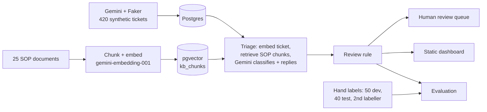

# LLM Ticket Triage with RAG

A support-ticket triage system for a fictional online store (Brightcart). Gemini classifies each ticket (category, priority) and drafts a reply, grounded in SOP documents retrieved from Postgres + pgvector. A risk-based rule routes uncertain or high-stakes tickets to a human review queue. Accuracy is measured honestly: hand-labelled tickets, a fresh test set, and a second labeller.

**Live dashboard:** https://henry20-ai.github.io/llm-ticket-triage-rag/ (enable GitHub Pages first, see the Dashboard section)

Stack: Python, Google Gemini API (`google-genai`), Postgres + pgvector (Docker), static HTML dashboard (Chart.js).

## Architecture

## Results (fresh test set, 40 tickets, labelled before any model output was seen)

| Measure | Result |
|---|---|
| Category correct | 85.0% (34/40, 95% CI 71-93%); always guessing the most common category: 28% |
| Priority exactly right | 62.5% (25/40, 95% CI 47-76%); baseline 48% |
| Priority within one level | 80.0% (32/40) |
| Category and priority both right | 52.5% (21/40, 95% CI 37-67%) |
| Two humans agreeing with each other | category 72.5% (kappa 0.66), priority 65.0% (kappa 0.51) |
| AI vs the second labeller | category 85.0%, priority 65.0% |
| Real Urgent tickets left unreviewed | 0 of 9 with the risk-based rule (the confidence rule missed 4 of 9) |

What this means: category is solid, priority is about as consistent as two people are with each other, and the system is decision support, not an autopilot. With 40 tickets the intervals are wide, so differences of a few points are noise.

## Key findings

1. **Model confidence is not a usable review signal.** Average stated confidence was 0.96 while only 53% of answers were fully right. A rule based on confidence flagged almost nothing. The review rule therefore looks at what is at stake: predicted High or Urgent priority and Billing & Payments tickets are always reviewed. The cost is that roughly 40-50% of tickets go to a person.
2. **Many "errors" were unclear rules, not model mistakes.** An error review of the first 50 tickets showed label and definition disagreements (for example invoices and promo codes belong to Billing, a defective item with a return request is a Product Issue). Rewriting the rules (v2) and re-testing on a fresh set kept the evaluation honest: rules were tuned on the dev set only.
3. **Priority is subjective.** Two humans agreed on exact priority 65% of the time (kappa 0.51), which is a realistic ceiling for any model.

## Limitations

- Synthetic tickets and LLM-written SOPs (generated from the same taxonomy), so real-world performance will differ.
- Small evaluation sets (50 dev, 40 test); wide confidence intervals.
- Medium-priority tickets are the most confused; App & Website issues are sometimes read as Delivery problems.
- The knowledge base is static. A follow-up project (RAG 2.0) keeps it in sync automatically when documents change.
- Free-tier Gemini limits shaped the design (batching embeddings, resumable runs).

## Setup

1. `python -m venv venv`, activate it, `pip install -r requirements.txt`
2. Start the database:
   `docker run -d --name pgvector-db -e POSTGRES_PASSWORD=<password> -e POSTGRES_DB=ticket_triage -p 5433:5432 -v pgvector_data:/var/lib/postgresql/data pgvector/pgvector:pg17`
   then `docker exec -it pgvector-db psql -U postgres -d ticket_triage -c "CREATE EXTENSION IF NOT EXISTS vector;"`
3. Copy `.env.example` to `.env` and fill in the API key and database password (never commit `.env`).
4. `python src/check_setup.py` - every check should pass.

## Pipeline steps

| Step | Command | What it does |
|---|---|---|
| 0 | `python src/init_db.py` | Creates the tables |
| 1 | `python src/generate_tickets.py` | Gemini writes ~420 synthetic tickets (resumable) |
| 2 | `python src/load_tickets.py` | Loads them into Postgres |
| 3a | `python src/generate_kb.py` | Gemini writes 25 SOP documents into `data/sops/` |
| 3b | `python src/embed_kb.py` | Chunks the SOPs, embeds them, stores vectors in `kb_chunks` |
| 3c | `python src/search_kb.py` | Tests retrieval with sample queries |
| 4 | `python src/make_eval_set.py` | Picks 50 DEV tickets for hand labelling; `--test` picks 40 fresh TEST tickets |
| 5 | `python src/load_eval_labels.py` | Validates and loads hand labels (`--set test`, or `--annotator friend --file ...` for a second labeller) |
| 6 | `python src/triage_tickets.py --eval` | RAG triage: embed, retrieve SOP chunks, Gemini classifies, risk-based review rule (`--test` for the test set) |
| 7 | `python src/evaluate.py` | Accuracy vs hand labels, review rules compared, human agreement (`--set test` for the final numbers) |
| 8 | `python src/build_dashboard.py` | Builds the static dashboard `docs/index.html` (volume, review queue, evaluation, ticket explorer) |

 are added as they are built.

## How triage decides

1. The ticket is embedded and the 3 closest SOP chunks are retrieved with pgvector (cosine distance). The "Escalation and priority" section of the best-matching SOP is always added.
2. Gemini returns reasoning, category, priority, a confidence score and a suggested reply, using only the retrieved excerpts.
3. Human-review rule (v2, risk based): `needs_review = TRUE` if the predicted priority is in `REVIEW_PRIORITIES` (default High, Urgent), the category is in `REVIEW_CATEGORIES` (default Billing & Payments), confidence < `CONFIDENCE_THRESHOLD`, or similarity < `MIN_RETRIEVAL_SIMILARITY`. The reasons are stored in `review_reason`. Model confidence alone proved useless on the dev set (average 0.94 stated vs 46% fully correct), which is why the rule looks at what is at stake.
4. Accuracy is measured against 50 tickets labelled by hand. The generator's own labels are never used as ground truth.

## Evaluation design

- **v1 baseline (dev set, 50 tickets):** category 80%, priority 58%, both correct 46%; confidence was not predictive. Kept in `output/evaluation_report_v1_baseline.md`.
- **v2:** category rules, priority definitions and examples rewritten after an error review (many "mistakes" were label/definition disagreements), risk-based review rule.
- **Test set (40 fresh tickets)** labelled under the final v2 guide before any AI output was seen; the numbers to quote come from there. Rules and prompt were tuned on the dev set only.
- Optional second labeller: human-human agreement (Cohen's kappa) is a realistic ceiling for the AI.

## Dashboard

`python src/build_dashboard.py` writes one self-contained page, `docs/index.html` (data embedded; only Chart.js is loaded from a CDN). Open it by double-clicking, or publish it free with GitHub Pages: repository **Settings -> Pages -> Deploy from a branch -> main, folder /docs**. Set `DASHBOARD_REPO_URL` in `.env` to show a link to this repository in the page footer. Rebuild after every triage or evaluation run.
